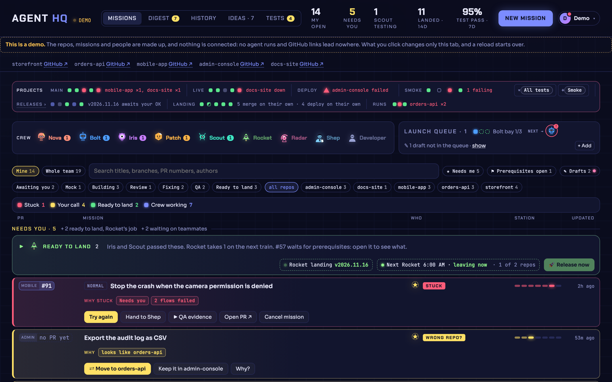
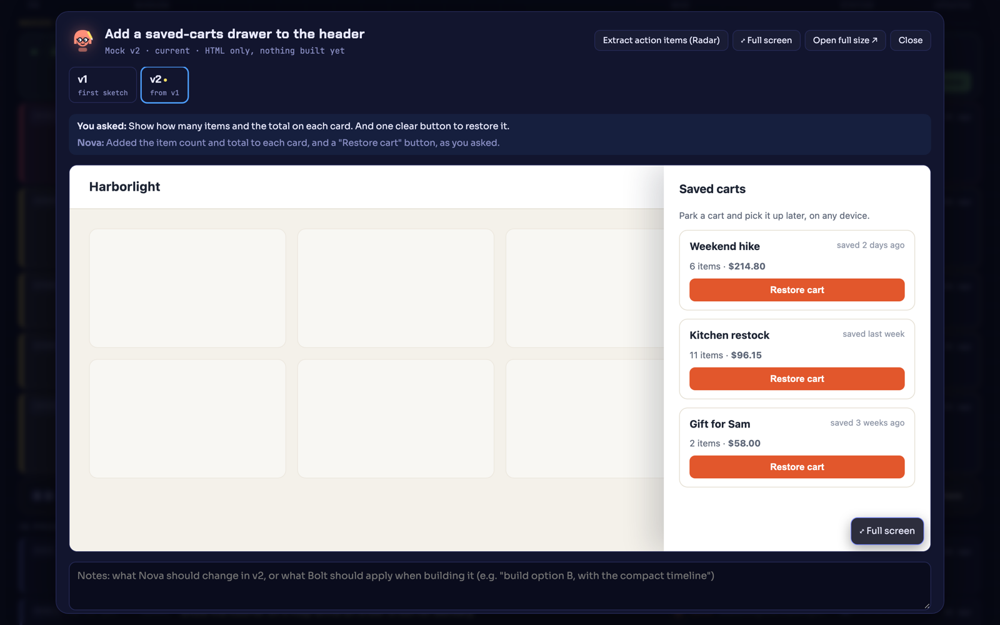
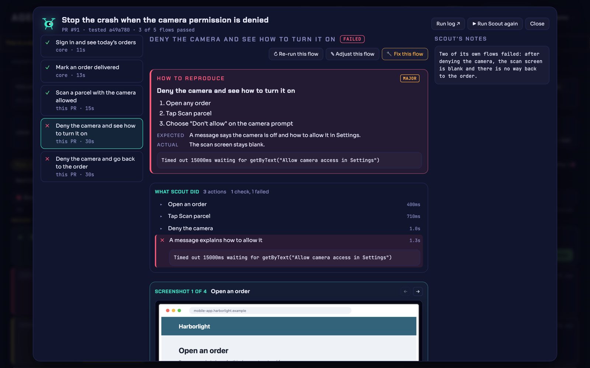
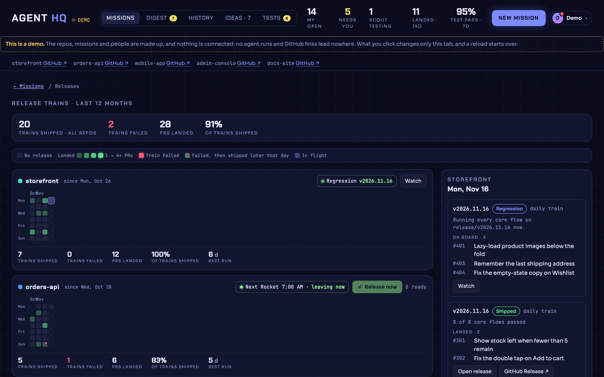

# Agent Crew

A crew of seven AI agents that works on your GitHub repo. Between them they design a change, build it,
review it, fix it, test it in a real browser and ship it. They run on GitHub Actions, in your repo, on
your own Claude account. Your repo keeps a few small files; the crew itself lives here and updates for
everyone at once.

| | Agent | Its job | Runs |
| --- | --- | --- | --- |
|  | **Nova**<br>designer | Turns a request into a clickable HTML mock in your app's own look, and revises it from your notes until you approve the direction. Nothing is built before that. | From Agent HQ, or `/crew` on your machine |
|  | **Bolt**<br>builder | Builds the approved mock on its own branch: writes the code and its tests, runs your lint, type-check and test commands, and opens a pull request. | From Agent HQ, or `/crew` on your machine |
|  | **Iris**<br>reviewer | Reads every pull request's diff against your conventions and comments on bugs, risky changes and missing tests, with a verdict and an impact label. She only comments; she never approves or merges. | On its own: every PR, or comment `/iris` |
|  | **Patch**<br>fixer | Fixes what the others found, on the PR's own branch: Iris's review comments, the flows Scout saw fail, a broken build, merge conflicts. Up to three rounds with Iris. | From Agent HQ, or `/crew` on your machine |
|  | **Scout**<br>tester | Starts your app on emulators, opens it in a real browser and tests the PR the way a user would: your core journeys plus flows it writes for this change. Posts what passed and failed, with screenshots and video. | On its own: label a PR `scout`, or comment `/scout` |
|  | **Rocket**<br>release | Lands the finished PRs into a release branch one at a time, runs your checks after each, resolves conflicts between them, and leaves out any PR it can't make work, with the reason. | From Agent HQ |
|  | **Radar**<br>analyst | Labels every PR's impact (`impact:low` to `impact:critical`) from your risk map, with no AI. On request it audits the repo for major upgrades, security advisories and cleanup. It proposes; it never changes code. | On its own: every PR; audits by hand |

Three of the crew work **on their own** in any repo you set up: Iris, Scout and Radar. Nova, Bolt and
Patch also run **on your machine**, free, as a [Claude Code skill](#build-on-your-machine): type `/crew`
and what to build. [Agent HQ](#agent-hq), the dashboard, runs the whole line in the cloud from request to
release, Rocket included. There is also a **production probe**: a few read-only checks against your live
site every 15 minutes, no AI.

No agent can merge. Reviews are comments, and landing a PR stays with a person.

## Set it up

**With Claude Code.** Open your repo and say:

> Read https://raw.githubusercontent.com/vehicle-care-network/agent-crew/main/SETUP.md and set up the agent crew in this repo.

Claude asks where the agents should run, copies the starter files for that choice, fills them in from
your code, runs the check script and opens a pull request.

| Where | What it takes | What you get |
| --- | --- | --- |
| **GitHub Actions** | One secret: your Claude credential | Iris and Radar on every pull request, Scout on request |
| **Vercel sandboxes** | An [Agent HQ](#agent-hq) | The whole crew, with no workflows or secret in the repo |
| **Your machine** | Claude Code | Nova, Bolt, Iris and Patch when you type `/crew`; nothing runs by itself |

[SETUP.md](SETUP.md#first-where-should-the-agents-run) compares the three.

**By hand.** Follow [SETUP.md](SETUP.md): it is the same steps, about ten minutes for Iris and Radar.

## What you need

- A GitHub repo with Actions on, and admin access to it.
- A Claude subscription (`claude setup-token`) or an Anthropic API key. Every run is billed to you, not to us.
- **Iris and Radar** work on any repo.
- **Scout** today tests **Next.js apps on Firebase** (Firestore and Auth): it starts your app with
  `next dev` against the Firebase emulators, so nothing it does can reach real data.

## What your repo keeps

```
.github/workflows/agent-iris.yml, agent-radar.yml, scout-qa.yml   thin callers: triggers, then `uses: …/agent-crew/…@v1`
.github/agents/crew.json        what the product is, how to install, lint and test it
.github/agents/risk-map.json    which paths are critical, high or low impact
.github/agents/*.notes.md       optional: your own additions to each agent's brief
.github/scout/, e2e/scout/, scripts/scout/    Scout only: the journeys that must not break, sign-in helper, seed data
.claude/skills/crew/            the `/crew` skill: Nova, Bolt, Iris and Patch on your machine, in Claude Code
```

Starters for every one of these are in [`templates/`](templates), and
`node scripts/setup/check.mjs` (run from your repo) tells you what is missing.

## Build on your machine

Setup also installs a [Claude Code](https://claude.com/claude-code) skill. In your repo, type:

> /crew add a way to export the bookings table as CSV

Nova designs it as an HTML mock that opens in your browser. You approve it or give notes. Bolt builds the
approved mock on a new branch, Iris reviews it, Patch fixes what she found, and when you say so it opens a
pull request for you to land. It all happens in your checkout, on the Claude account Claude Code is
signed in to: no dashboard, no server, nothing pushed before you agree, and nothing merged for you.

The agents follow the same briefs as on GitHub, fetched at the crew's current release. Scout and Rocket
are not part of it. [SETUP.md](SETUP.md#build-something-with-the-crew-on-your-machine) has the details.
When you want this in the cloud, with a dashboard and several missions at once, that is Agent HQ.

## Agent HQ

Agent HQ is the dashboard for the whole crew. You write a mission; Nova sketches it, you approve, Bolt
builds it, Iris and Scout check it, Patch fixes what they find, and Rocket lands the finished PRs in a
release. It shows every mission, who is on it and what needs you.

**[Try the demo → agent-hq-demo.vercel.app](https://agent-hq-demo.vercel.app)**: the whole dashboard with
made-up repos and missions. No account needed, nothing is connected, and a reload starts over.

[](https://agent-hq-demo.vercel.app)

| Approve Nova's mock before anything is built | Watch what Scout did, step by step | See every release Rocket shipped |
| --- | --- | --- |
| [](docs/hq/mock.png) | [](docs/hq/evidence.png) | [](docs/hq/releases.png) |

HQ is a separate product, set up for each team on its own accounts. The crew in this repo is free and
works without it, on GitHub and [on your machine](#build-on-your-machine).

With an HQ, set the repo or organization variable `AGENT_HQ_URL` to its address and copy
`templates/hq/`. Without that variable a run talks only to GitHub and Claude.

## More

- [SETUP.md](SETUP.md): install the crew in a repo, step by step, with fixes for what goes wrong.
- [docs/reference.md](docs/reference.md): how everything works: Scout's modes, the three tiers of
  testing, releases, models, access, forking, and how this repo is released.
- [CHANGELOG.md](CHANGELOG.md): what changed in each version. Callers pin `@v1`.

## License

[MIT](LICENSE).
